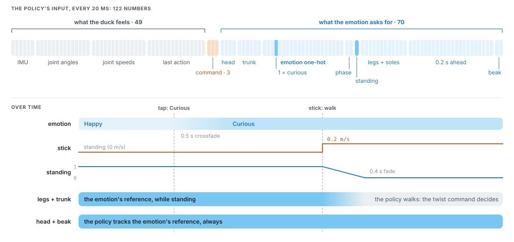
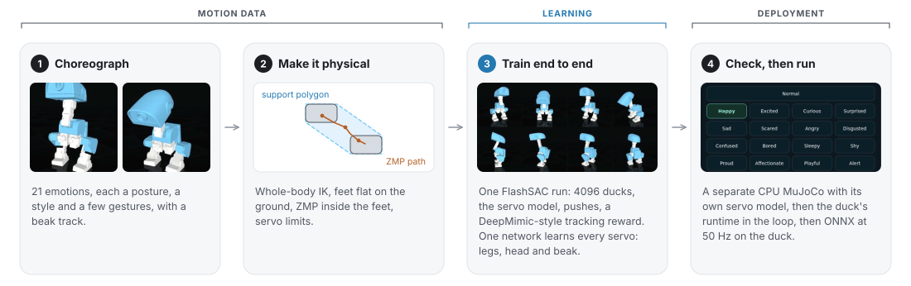

<a class="duck-try" href="/sims/xgoduck/" target="_blank" rel="noopener">Try it in the simulator</a>

I don't like writing papers about this kind of thing, so I'm writing a blog post instead. This one is about S0, system zero: the low-level controller of the duck. It's one network that controls every servo on the robot, trained purely with RL and deployed from simulation to the real duck.

S0 is not the emotional intelligence. That sits on top of it. An LLM, Astra, Opus, whatever runs the duck's mind, is what I'd call S1, and it works through S0: it picks a velocity and an emotion, and S0 does it on the robot. This post is about how I train S0.

<figure class="duck-media">
<video autoplay muted loop playsinline controls preload="metadata" src="media/real_emotions.mp4" poster="media/real_emotions_poster.jpg"></video>
<figcaption>S0 on the real duck.</figcaption>
</figure>

## The policy

The robot is an XgoDuck: 0.79 kg, 14 joints plus a beak, Feetech HLS1910 servos. 32% of the mass is in the head, so you can't move the head without the rest of the body having to deal with it.

S0 is a tracking controller. Next to the network, a small reference player runs on the duck. It holds the choreography of the 21 emotions and plays the one you picked. The network gets a vector of 122 numbers: what the duck feels (gyro, gravity, the 14 joint angles and speeds, its last action), the velocity command, a one-hot of the emotion, and from the player the pose it should be in now and 0.2 s ahead, for the head, the trunk, the legs and the beak. It gives back 15 target positions, one per joint plus the beak. That's it.

## Walking and emoting at the same time

<figure class="duck-wide">

<figcaption>Top: the 122 inputs. Bottom: what happens when you pick an emotion and then start walking.</figcaption>
</figure>

The emotion goes straight into the network as a one-hot over 21 classes, with the reference pose and beak track for that emotion, now and 0.2 s ahead. There is no separate walking controller; walking and the emotion come out of the same network.

## The pipeline

<figure class="duck-wide">

</figure>

It starts with the choreography: for each emotion, a posture, a style and a few gestures. A whole-body IK pass puts it on the duck's joints with the feet flat on the ground.

These motions are not physically grounded, so the training has to be. The policy learns to track them in simulation with a DeepMimic-style reward, and what comes out is what the duck can physically do.

Training is a single FlashSAC run in mjlab on MuJoCo Warp: 4096 ducks in parallel, a model of the servos (torque curve, 15 ms delay, gear play) and random pushes. Walking, turning, the 21 emotions, the head and the beak all come out of that one run.

<figure class="duck-media">
<video autoplay muted loop playsinline controls preload="metadata" src="media/emotions.mp4" poster="media/emotions_poster.jpg"></video>
<figcaption>All 21 emotions in simulation.</figcaption>
</figure>

Before anything goes near the hardware, I run the policy in a separate CPU MuJoCo with its own servo model, and then with the duck's runtime code in the loop.

<figure class="duck-media">
<video autoplay muted loop playsinline controls preload="metadata" src="media/tour.mp4" poster="media/tour_poster.jpg"></video>
<figcaption>A tour in the CPU MuJoCo check. The gauge is the beak servo.</figcaption>
</figure>

## On the real duck

S0 runs as an ONNX model inside the duck's runtime. Switching the emotion is one call from whatever sits above it. The calmer emotions hold up well. The bouncy ones and walking still fall from time to time, and the stock get-up controller puts it back on its feet.

<figure class="duck-media">
<video autoplay muted loop playsinline controls preload="metadata" src="media/real_getup.mp4" poster="media/real_getup_poster.jpg"></video>
</figure>

## Try it

<figure class="duck-wide">
<iframe class="duck-sim" src="/sims/xgoduck/" title="XgoDuck simulator: walk the duck and pick its emotion" loading="lazy" allow="fullscreen" allowfullscreen></iframe>
<figcaption>The same network, in your browser, on MuJoCo compiled to WebAssembly. W/S to walk, A/D to turn, Space to push it, and Inputs shows what the network is seeing. <a href="/sims/xgoduck/" target="_blank" rel="noopener">Open it full screen</a>.</figcaption>
</figure>
